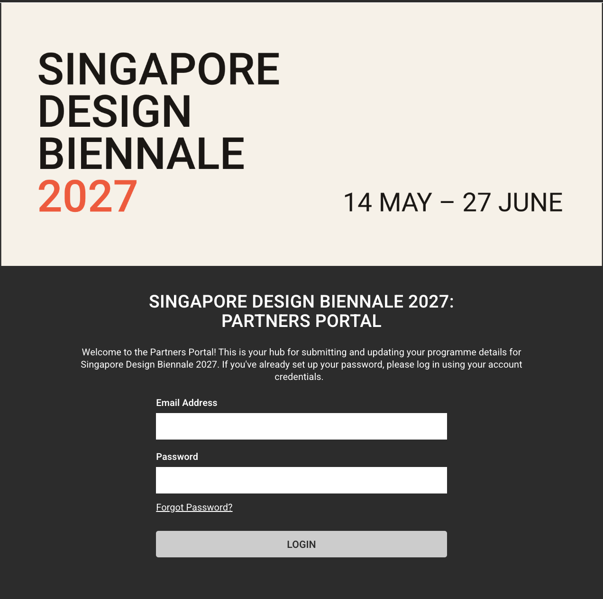

**Singapore Design Biennale 2026 & 2027**

**Custom WordPress Partner Portal Development**

📌 Project Overview

This project involved the development and enhancement of custom WordPress-based partner portals for Singapore Design Biennale (SDB) 2026 and 2027.

The portal was designed to support event submission, review, approval, and management workflows through different user roles.

I contributed to the development of custom backend functionality, dynamic forms, dashboard interfaces, data management, and administrative workflows.

**Project:** Singapore Design Biennale 2026 & 2027  
**Platform:** WordPress  
**Project Type:** Custom Web Application / Partner Management Portal

---

🛠️ Technologies Used

| Category | Technologies |
|---|---|
| Backend | PHP |
| CMS | WordPress |
| Database | MySQL |
| Custom Fields | Advanced Custom Fields (ACF) |
| Frontend | HTML5, CSS3, JavaScript |
| JavaScript Libraries | jQuery |
| Data Integration | WordPress Database API |

---

👨‍💻 My Contributions

I contributed to the development and maintenance of the partner portal across the 2026 and 2027 versions.

1. Role-Based Portal Management

Developed and maintained portal functionality for different user roles:

- EP Team
- OE Team (no more for 2027)
- BMC Team
- Super Admin

Implemented role-based access and customized dashboard functionality based on user permissions.

**Login Form**

- Custom login form interface.
- Email and password authentication.
- User account verification.
- Role-based access to the appropriate portal dashboard.
- Session-based user authentication.
- Access control based on assigned user roles.

After successful login, users are directed to their respective dashboards according to their assigned roles.

2. Dynamic Form Development

- Developed custom multi-section forms using PHP and WordPress.
- Implemented dynamic form fields and conditional UI behavior.
- Developed form validation for different input types.
- Implemented date and programme validation.
- Integrated custom field management using Advanced Custom Fields (ACF).

3. Event Submission & Review Workflow

- Developed event submission and editing functionality.
- Implemented submission status management.
- Developed review and approval workflows.
- Implemented revision tracking and status updates.
- Supported communication and review processes between different portal roles.

4. Dashboard & Data Management

- Developed custom dashboards for managing event submissions.
- Implemented filtering, sorting, and record selection functionality.
- Developed dynamic status displays and submission summaries.
- Implemented database operations for managing event records.

5. Data Export & File Management

- Developed custom data export functionality.
- Implemented Excel export features.
- Worked on event-related media and file management.
- Implemented export file organization and ZIP archive generation.

6. Frontend Development

- Developed interactive user interfaces using HTML, CSS, JavaScript, and jQuery.
- Implemented dynamic form interactions.
- Improved dashboard usability and frontend behavior.
- Worked on responsive layouts and UI improvements.

---

⚙️ Key Features

- Multiple role-based partner portals.
- Dynamic event submission forms.
- Multi-section form validation.
- Event submission and editing.
- Review, approval, and revision workflows.
- Submission status tracking.
- Dashboard filtering and sorting.
- Excel data export.
- Media and file management.
- Role-specific administrative functionality.

---

🏗️ Application Workflow

The portal supports a workflow involving different user roles:

1. Partners submit and manage event information.
2. OE Team reviews submissions and requests revisions when necessary.
3. BMC Team manages its assigned review and management processes.
4. Super Admin manages administrative operations.
5. Submission statuses are updated throughout the workflow.

---

📚 Technical Experience & Learning

Through this project, I gained practical experience in:

- Developing complex WordPress applications beyond standard themes.
- Building custom PHP functionality.
- Managing user roles and permissions.
- Working with WordPress database operations.
- Developing dynamic forms and validation logic.
- Implementing multi-step business workflows.
- Handling data exports and file management.
- Debugging and maintaining large WordPress-based applications.

---

🔒 Project Confidentiality

This repository is a professional project case study describing my development contributions.

The original project source code, database records, credentials, internal configurations, and confidential client information are not included.

---

👩‍💻 Developer

**Ei Phyu Thant**

PHP Developer | WordPress Developer | Web Developer

- GitHub: [@eiphyuthant697](https://github.com/eiphyuthant697)
- Portfolio: [My Portfolio](https://eiphyuthant697.github.io/profolio/)
- LinkedIn: [My LinkedIn](https://www.linkedin.com/in/ei-phyu-thant-21181837a)

---

*This case study represents my professional contributions to the project and does not contain the original proprietary application source code.*
